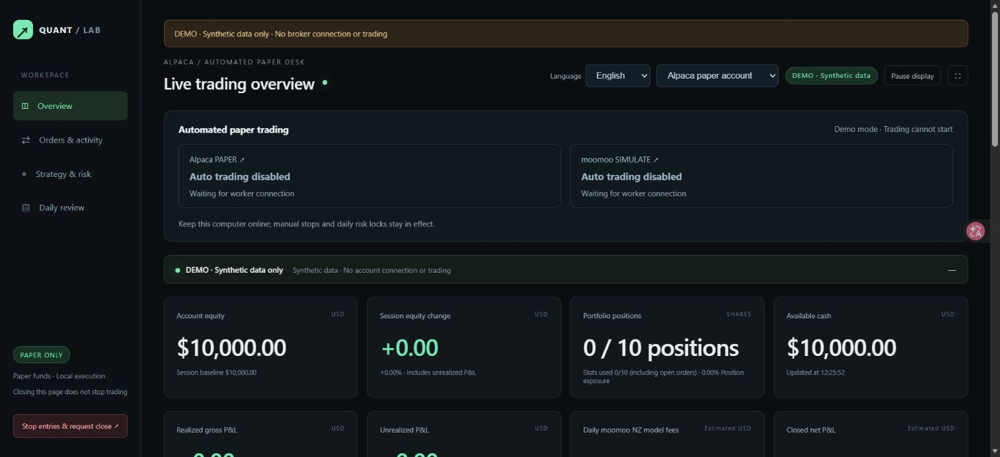

# Stock Quant Lab

[](https://github.com/9yen/stock-quant-lab/actions/workflows/tests.yml)

[English](README.md) | [简体中文](docs/README.zh-CN.md)

A local, bilingual paper-trading lab for learning how market data, intraday signals, execution, reconciliation and risk controls fit together. Built with Python and a lightweight browser dashboard for Alpaca Paper and moomoo SIMULATE.

**Learning comes first. This is an experiment, not a signal service, financial advice, or a promise of profitable trading. Live-money execution is outside this project's supported scope.**

## Try the interface without an account

With Docker Desktop running in Linux-container mode:

```sh
docker compose up -d --build --wait
```

Open <http://127.0.0.1:8767/>. This container runs the synthetic demo only.
Full PAPER execution is available through a separate, explicitly activated Compose deployment. See [Docker deployment](docs/DOCKER.md)
for logs, shutdown and execution migration limits.

Python 3.12+ is required. Native automation supports Windows; the full Docker runtime uses Linux process checks and file locks. The web backend and demo do not require Tk. The optional desktop window does.

```powershell
git clone https://github.com/9yen/stock-quant-lab.git
cd stock-quant-lab
python -m venv .venv
.\.venv\Scripts\python.exe -m pip install -r requirements.txt
.\.venv\Scripts\python.exe -m quant_lab demo
```

Open <http://127.0.0.1:8767/>. The demo uses generated candles, temporary local files and no broker connections. Both desks have an English / 简体中文 selector. Your language choice stays in your browser and carries across desks. The demo has no real account, fills or returns.

Use Docker for the tested Linux execution environment. OpenD still needs a separate logged-in gateway; account permissions are not bundled in the project.



## What you can study

- [Independent paper budgets](docs/STRATEGY_BUDGET.md) without resetting broker balances.
- One-minute opening-range breakout signals with MA20, VWAP, volume and bounded-range filters.
- Long and short **whole-share** paper orders across a curated 100-stock universe. This is not an official Nasdaq-100 membership feed.
- Reserved exposure for pending orders, position slots, entry limits, persistent intents and order reconciliation.
- Candles, custom moving averages, volume, actual-fill markers, per-symbol P&L and daily reviews.
- Continuous paper session management and recovery of exited workers without erasing stops or daily risk locks.
- A separate small long-option pilot on eligible moomoo paper accounts. No naked options or 0DTE strategy.
- Bounded stock-filter evaluation with chronological training, validation, holdout and slippage stress tests.

## Understand the boundaries

A fresh clone contains **no credentials, account authorizations, broker history, enabled automation or installed login tasks**. Running the demo does not create any of those. Running the web dashboard alone does not enable trading.

Paper execution still creates orders in a broker's simulation. Use a dedicated paper account and explicitly configure it locally before starting an executor. The existing setup is not yet a general-purpose, one-click onboarding product. Do not copy someone else's account binding or order ledger.

The daily manager binds to the existing Alpaca paper account and carries forward the authorized policy only after checking the official session calendar, old positions and orders. Unreconciled previous sessions block rollover. moomoo requires OpenD on `127.0.0.1:11111`, logged in with applicable account/data permissions. Tiger is discovery-only and is not an enabled executor.

The web service binds to loopback, not the internet. Do not expose it as a public multi-user trading service.

## Current configured policy

These are the implemented local defaults, not recommendations for a reader's real account. Independent broker restrictions still apply.

| Rule | Alpaca Paper | moomoo SIMULATE |
| --- | --- | --- |
| New stock allocation target | 10% of equity | 10% of equity |
| Single-stock hard cap / total gross cap | 40% / 100% | 40% / 100% |
| Concurrent stock/underlying slots | 10, including reserved entries | 10, including reserved entries |
| Daily entry limits | 19/symbol, 100 total | 19/symbol, 100 total including options |
| Per-symbol cooldown | 15 minutes | 5 minutes |
| Stock stop / take-profit | 1% / 2% | 1% / 2% |
| Strategy daily loss budget | 1% of session baseline equity | 2% of daily baseline equity |
| Entry cutoff / planned flatten | 30 / 10 minutes before official close | 30 / 10 minutes before official close |

Gross exposure adds absolute long and short notionals; it does not net them. A hard cap is not a target. Actual fills, slippage, gaps and outages can exceed planned losses. moomoo stops are local software checks, not broker-held protective orders.

Small accounts may produce zero-share orders because allocation is rounded down to whole shares. Fixed fees can consume a large part of small trade gains. Fractional orders, shorting and option contracts have different constraints; this strategy does not become suitable for a small live account by lowering the simulated starting balance.

## P&L and fees

Alpaca reviews use an **estimated moomoo NZ whole-share fee model**, not actual Alpaca charges. Fee rates can change; verify the [official moomoo NZ schedule](https://www.moomoo.com/nz/support/topic13_19). moomoo simulated-order responses do not currently supply the fee detail needed for precise per-trade net reconciliation, so strategy reports label gross P&L and show account-equity changes separately.

Closed-trade returns use matched entry notional, not account equity. Partial fills can produce multiple FIFO matched lots. Account equity includes unrealized P&L; a profitable paper day is not evidence of a reliable live edge. Borrow fees, market impact, queue position and paper/live fill differences are not fully modeled.

## Optional broker environments

The base install supports the demo, local status and diagnostics. Add `.[alpaca,research]` for Alpaca and research, and `.[dev,alpaca,research]` for development/tests. Keep gateway SDKs isolated:

```powershell
python -m venv .venv-brokers
.\.venv-brokers\Scripts\python.exe -m pip install -r requirements-brokers.txt
```

Copy `.env.example` to `.env` locally and enter **paper** keys only if you want account reads. Never commit `.env` or account state. See [the Chinese operating guide](docs/README.zh-CN.md) for the currently configured installation, and [SECURITY.md](SECURITY.md) for boundaries. Do not run the automatic entry points until you have explicitly authorized and verified the local simulation configuration.

## Tests and contribution

```powershell
.\.venv\Scripts\python.exe -m unittest discover -s tests
node --test tests/test_i18n.cjs
```

Tests use mocks, synthetic bars and temporary ledgers. GitHub Actions runs offline tests and JavaScript syntax checks on Windows; it does not need broker keys. Passing tests does not establish profitability.

Translations are source-string catalogs in `src/quant_lab/dashboard/assets/locales/`, shared by both dashboards. Contributions in either language are welcome. See [CONTRIBUTING.md](CONTRIBUTING.md). Useful next steps include portable account onboarding, stronger execution replay, more complete cost models and additional languages.

## Engineering layout and operations

The application is an installable `src/quant_lab` package, with one public CLI:

```powershell
python -m quant_lab --help
python -m quant_lab doctor --json
python -m quant_lab status --json
python -m quant_lab dashboard
# Existing authorized local paper installations only:
python -m quant_lab supervise
```

Use `--home PATH` before the command, or `QUANT_LAB_HOME`, to select a writable runtime home. Web assets are packaged with the application; credentials, journals, logs and stop flags remain outside installed code. Optional non-secret settings live in `config/local.toml`; see `config/local.example.toml`. The dashboard only permits loopback binding.

| Package | Responsibility |
| --- | --- |
| `strategies/` | Signals, indicators, entry filters and exit decisions |
| `brokers/alpaca/`, `brokers/moomoo/` | Broker-specific account reads, execution and reconciliation |
| `analytics/` | FIFO P&L, fee models, research and daily evaluation |
| `services/` | Worker supervision and automatic session lifecycle |
| `runtime/` | Paths, settings validation, atomic storage and structured service logs |
| `dashboard/` | Read-only web data/API, optional native window, demo and packaged browser assets |
| `tests/` | Offline behavior, failure recovery and localization tests |
| `examples/legacy/` | Historical learning exercises, separate from the application |

[Architecture](docs/ARCHITECTURE.md) · [Development and packaging](docs/DEVELOPMENT.md) · [Migration from root scripts](docs/MIGRATION.md) · [Changelog](CHANGELOG.md)

Older preview and backtest scripts are learning exercises and may use earlier strategies. They do not define the current intraday policy. No personal trading results or screenshots are included in this repository.

MIT licensed. Broker names and SDKs belong to their respective owners; this project is not affiliated with or endorsed by them.
